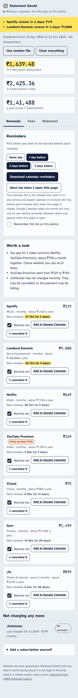

# Statement Sleuth

Find the bank fees you can ask back, find the subscriptions you forgot, and get a reminder before the next one renews.

**Live demo: https://jay-m007.github.io/statement-sleuth/** (click "Try it with a sample statement")



## The startup this comes from

[Cushion](https://www.loot-drop.io/) (raised about $15M, shut down in 2025) got customers refunds for bank fees. It needed live access to people's bank accounts, and banks began blocking it. This project keeps the useful part and removes the dependency: you give it a statement file, it works on your own device, and no bank connection is needed.

## What it does

1. **Reads a bank statement CSV.** Finds the header even with junk lines above it; handles separate Debit/Credit columns or one signed Amount; reads `05/03/26`, `5 Mar 2026`, `₹1,299.00 Dr`, `(500.00)` and similar.
2. **Finds fees:** overdraft, late payment, minimum balance, ATM, annual, SMS, foreign-exchange markup, returned cheque, maintenance, transfer. A GST/tax line next to a fee is added to it. A fee that already has a matching refund is marked as refunded.
3. **Says how likely a request is to work.** First-time fees rate higher than repeat ones. It says "worth asking", never "you will get this back".
4. **Writes the letter.** A polite, specific request you can edit, copy, or open in your email app. No legal claims.
5. **Finds subscriptions:** repeating payments (weekly, monthly, every 3 months, yearly) with a steady amount, plus known services (Netflix, Spotify, Prime, iCloud and so on). Shows price rises, services that stopped charging, and overlaps such as two music apps.
6. **Reminds you before renewals.**
   - **Calendar file (.ics):** one repeating event per subscription with alerts at the times you pick (same day, 1, 3, 7 days before). Apple Calendar and Outlook keep the alerts and ring even when this site is closed. Google Calendar adds the events but may apply its own default reminder.
   - **Browser alerts and a yellow bar** when you open the page and something is due soon.
   - **Add your own** subscriptions (for example an annual plan) and keep the list on your device.
7. **Spots possible double charges** (same text and amount within two days).

## Privacy

Everything runs in the browser. The page has a Content Security Policy with `connect-src 'none'`, so it cannot send data anywhere, and it loads no outside scripts, fonts or analytics. The statement is kept in memory only. If you choose "Remember this list", only the subscription names, amounts and dates are saved in this browser's local storage; "Clear everything" removes them.

Statement text is untrusted input: the page builds its DOM with `textContent` only, and a description like `` is shown as plain text (checked in a real browser).

## Honest limits

- CSV only (no PDF, no Excel directly). Bank formats vary; if yours is not read correctly, the error says what is missing.
- Detection is rule-based. It can miss a subscription with only one charge in the file, and can flag a repeating payment that is not a subscription (rent, for example). You can untick or remove any of them.
- A web page cannot ring your phone when it is closed. That is why the calendar file exists, and why an Android app is the next step ([docs/APP-PLAN.md](docs/APP-PLAN.md)).
- Refund chances are rules of thumb from how banks commonly behave, not data about your bank.
- Not legal or financial advice.

## Run it

```
npm test        # 44 tests, no dependencies
npm run serve   # builds site/ and serves http://localhost:8080
```

Requires Node 18 or newer. No packages to install.

## How it is built

```
engine/csv.js      CSV parsing, column detection, dates, amounts
engine/fees.js     fee rules, GST matching, refund matching, duplicates
engine/subs.js     merchant cleaning, cadence detection, next due date, insights
engine/ics.js      calendar file with alerts; Google Calendar link
engine/letters.js  refund / waiver letters
engine/sample.js   demo statement, built backwards from today
web/               the page (plain HTML, CSS, JavaScript modules)
tools/build.js     copies web/ and engine/ into site/ for publishing
```

The engine has no browser code, so the tests run it in plain Node.

## Next

An Android app using the same code (Capacitor) with real on-phone notifications. Costs and steps: [docs/APP-PLAN.md](docs/APP-PLAN.md).
